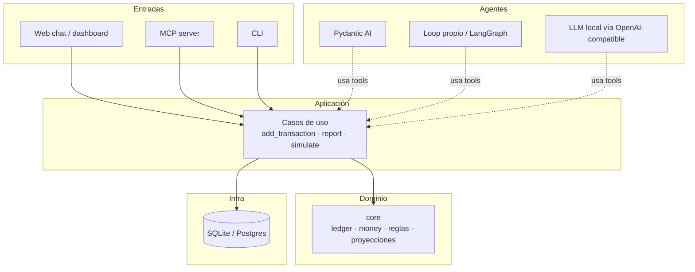

# Sope — Notas de diseño

> Documento vivo. Acá quedan las decisiones, el porqué y lo que falta.
> Última actualización: 2026-11-02

---

## 1. La idea en una frase

**Sope es un asistente financiero personal que se maneja por chat: registra gastos, entiende obligaciones, evalúa ideas ("¿puedo irme de vacaciones?") y mantiene planes actualizados sin que el usuario toque una hoja de cálculo.**

El usuario escribe en lenguaje natural. El agente traduce eso a operaciones determinísticas sobre un ledger. Los números nunca los inventa el modelo: los calcula el core.

---

## 2. Usuario y producto

- **Primer usuario:** familiares. No es un producto masivo todavía.
- **Modelo:** SaaS hosteado por nosotros, simple, con login y chat web.
- **Unidad de datos:** *household* (hogar). Varios miembros comparten el mismo ledger.
- **No** es un plugin de OpenCode. OpenCode es una herramienta de desarrollo y, opcionalmente, un cliente más vía MCP.
- **No** se cobra por ahora. Si alguna vez se cobra, será suscripción por household, no por asiento.

### Qué NO es

- No es un bot de trading.
- No es un reemplazo de un contador.
- No es una app de presupuesto con formularios interminables.
- No es un agente que "razona" los saldos: los saldos salen de la base.

---

## 3. Principios

1. **El modelo decide, el core calcula.** Cero aritmética mental del LLM.
2. **Una sola fuente de verdad:** la base de datos. Los planes y dashboards son vistas generadas.
3. **El agente es reemplazable.** El core no sabe si lo llama Pydantic AI, OpenCode, un LLM local o un script.
4. **El ledger es append-only.** Una transacción no se "edita" a mano; se corrige con un movimiento o una operación explícita.
5. **Dinero en enteros.** `amount_minor: int` + `currency`. Nunca `float`.
6. **Primero simple, después escalable.** SQLite y un VPS alcanzan para una familia. Postgres se migra cuando haga falta.
7. **Los datos son sensibles.** Aunque sean familiares: HTTPS, backups probados, sin logs con montos.

---

## 4. Decisiones tomadas

| Fecha | Decisión | Motivo |
|---|---|---|
| 2026-11-02 | Backend en **Python** | Comodidad con el ecosistema; un solo lenguaje para SaaS + agente |
| 2026-11-02 | **SQLite** primero, Postgres después | Cero ops, un archivo por household, backup trivial |
| 2026-11-02 | **SaaS web** para la familia | No depender de que cada uno instale OpenCode |
| 2026-11-02 | **Nada de plugin TS** en la v1 | El producto no vive dentro de OpenCode |
| 2026-11-02 | **MCP opcional** para integrar con OpenCode | Es el puente estándar; ~30 líneas, sin infra extra |
| 2026-11-02 | **Arquitectura hexagonal** | Cambiar agente/modelo/DB sin reescribir el dominio |
| 2026-11-02 | **Tool registry único** | Una definición, múltiples agentes y transportes |
| 2026-11-02 | **Household** como tenant | Es el modelo real de una familia; evita multi-tenancy prematuro |

### Alternativas descartadas

- **JSONL como fuente de verdad:** no tiene constraints, transacciones ni índices. Se puede usar como *export* legible, no como DB. Ver §9.
- **MongoDB:** los datos son relacionales; además requiere servidor. SQLite gana.
- **Plugin de OpenCode en TypeScript:** obliga a duplicar lógica o a hacer un shim que shell-out a Python. Más trabajo, menos reutilización.
- **Un solo OpenCode server para todos los clientes:** las sesiones no son un límite de seguridad. Riesgo de privacidad.

---

## 5. Arquitectura



Regla de dependencias: **las flechas apuntan hacia adentro**. `core/` no importa FastAPI, SQLAlchemy, OpenAI ni Pydantic AI. Si eso pasa, la modularidad se rompió.

### Estructura objetivo

```text
1sope/
├── pyproject.toml
├── NOTES.md
├── README.md
├── docker-compose.yml
├── src/sope/
│   ├── core/              # dominio puro
│   │   ├── models.py      # Transaction, Idea, Recurring
│   │   ├── money.py       # Money, minor units, Decimal
│   │   ├── ledger.py
│   │   └── simulation.py
│   ├── application/       # casos de uso
│   │   ├── add_transaction.py
│   │   ├── report.py
│   │   └── simulate.py
│   ├── ports/             # Protocols
│   │   ├── repositories.py
│   │   └── agent.py
│   ├── adapters/
│   │   ├── db/sqlite.py
│   │   ├── agents/pydantic_ai.py
│   │   ├── agents/openai_loop.py
│   │   └── transports/http.py, mcp.py, cli.py
│   ├── tools/registry.py  # definición canónica de tools
│   ├── api/               # FastAPI, auth, SSE
│   ├── agent/             # prompts + runtime elegido
│   ├── config.py
│   └── container.py       # composition root
├── migrations/
├── tests/
└── prompts/sope.md        # instrucciones compartidas
```

---

## 6. Stack

| Capa | Elección | Notas |
|---|---|---|
| Gestión de proyecto | `uv` | Rápido, lockfile reproducible |
| API | FastAPI | Async, OpenAPI, SSE |
| Validación | Pydantic v2 | Mismos modelos para API y tools |
| ORM / DB | SQLAlchemy 2.0 + Alembic | Migraciones desde el día uno |
| DB motor | SQLite (1 archivo por household) | `VACUUM INTO` para backup |
| Dinero | `Decimal` para cálculo, `int` en DB | Nunca float |
| Fechas | `datetime.date`, `zoneinfo` | Guardar ISO 8601 |
| IDs | UUIDv7 o ULID | Ordenables por tiempo |
| MCP (opcional) | `mcp` / FastMCP | stdio local, Streamable HTTP remoto |
| Agente | Pydantic AI (v1) | Alternativa: loop propio con SDK OpenAI |
| Modelo | OpenAI-compatible | OpenAI, Ollama, vLLM, LM Studio |
| Web | Jinja + HTMX (v1) | React solo si hace falta |
| Deploy | Docker Compose + Caddy | Un VPS |
| Backups | Litestream o cron + `VACUUM INTO` | Probar el restore, no solo el backup |

---

## 7. Modelo de datos

Entidades principales:

```text
households   (id, name, created_at)
members      (id, household_id, email, password_hash, role)
accounts     (id, household_id, name, currency, kind)
categories   (id, household_id, name, parent_id)
transactions (id, household_id, account_id, category_id,
              kind, status, amount_minor, currency,
              occurred_on, description, external_id, created_at)
recurring    (id, household_id, description, amount_minor, currency,
              category_id, account_id, frequency, day_of_month,
              next_due_on, active)
ideas        (id, household_id, title, status, estimate_minor,
              currency, target_date, notes, created_at)
```

### Reglas

- `amount_minor` es **siempre positivo**; el signo lo da `kind` (`expense` / `income` / `transfer`).
- `status` distingue `planned` (a pagar) de `paid` (hecho) y `canceled`.
- `external_id UNIQUE` para deduplicar reintentos e importaciones.
- `recurring` es la **regla**; las transacciones son las **instancias**. No guardar el alquiler 12 veces.
- `ideas` no afecta el ledger hasta que se materializa como `planned` o `paid`.
- Los **planes** (`plans/`) no van a la DB como fuente de verdad: se generan desde consultas + narrativa del agente. Si se cachean, es solo por performance.

### Esquema SQL inicial

```sql
PRAGMA journal_mode = WAL;
PRAGMA foreign_keys = ON;

CREATE TABLE households (
  id         TEXT PRIMARY KEY,
  name       TEXT NOT NULL,
  created_at TEXT NOT NULL
);

CREATE TABLE members (
  id            TEXT PRIMARY KEY,
  household_id  TEXT NOT NULL REFERENCES households(id),
  email         TEXT NOT NULL UNIQUE,
  password_hash TEXT,
  role          TEXT NOT NULL DEFAULT 'member'
                CHECK (role IN ('owner','admin','member')),
  created_at    TEXT NOT NULL
);

CREATE TABLE accounts (
  id           TEXT PRIMARY KEY,
  household_id TEXT NOT NULL REFERENCES households(id),
  name         TEXT NOT NULL,
  currency     TEXT NOT NULL DEFAULT 'ARS',
  kind         TEXT NOT NULL CHECK (kind IN ('cash','bank','card','investment')),
  created_at   TEXT NOT NULL
);

CREATE TABLE categories (
  id           TEXT PRIMARY KEY,
  household_id TEXT NOT NULL REFERENCES households(id),
  name         TEXT NOT NULL,
  parent_id    TEXT REFERENCES categories(id),
  UNIQUE (household_id, name)
);

CREATE TABLE transactions (
  id           TEXT PRIMARY KEY,
  household_id TEXT NOT NULL REFERENCES households(id),
  account_id   TEXT NOT NULL REFERENCES accounts(id),
  category_id  TEXT REFERENCES categories(id),
  kind         TEXT NOT NULL CHECK (kind IN ('expense','income','transfer')),
  status       TEXT NOT NULL CHECK (status IN ('planned','paid','canceled')),
  amount_minor INTEGER NOT NULL CHECK (amount_minor > 0),
  currency     TEXT NOT NULL,
  occurred_on  TEXT NOT NULL,
  description  TEXT NOT NULL,
  external_id  TEXT UNIQUE,
  created_at   TEXT NOT NULL
);

CREATE INDEX idx_tx_household_date ON transactions(household_id, occurred_on);
CREATE INDEX idx_tx_account_date   ON transactions(account_id, occurred_on);

CREATE TABLE recurring (
  id           TEXT PRIMARY KEY,
  household_id TEXT NOT NULL REFERENCES households(id),
  description  TEXT NOT NULL,
  amount_minor INTEGER NOT NULL CHECK (amount_minor > 0),
  currency     TEXT NOT NULL,
  category_id  TEXT REFERENCES categories(id),
  account_id   TEXT REFERENCES accounts(id),
  frequency    TEXT NOT NULL CHECK (frequency IN ('weekly','monthly','yearly')),
  day_of_month INTEGER CHECK (day_of_month BETWEEN 1 AND 31),
  next_due_on  TEXT NOT NULL,
  active       INTEGER NOT NULL DEFAULT 1
);

CREATE TABLE ideas (
  id             TEXT PRIMARY KEY,
  household_id   TEXT NOT NULL REFERENCES households(id),
  title          TEXT NOT NULL,
  status         TEXT NOT NULL CHECK (status IN ('idea','planned','booked','done','discarded')),
  estimate_minor INTEGER,
  currency       TEXT,
  target_date    TEXT,
  notes          TEXT,
  created_at     TEXT NOT NULL
);
```

---

## 8. Tools canónicas

Una sola definición en `tools/registry.py`, consumida por todos los agentes y transportes.

| Tool | Qué hace | Scope |
|---|---|---|
| `add_transaction` | Registra un gasto/ingreso ya realizado | write |
| `add_recurring` | Alta de obligación o gasto fijo | write |
| `report` | Ingresos, gastos, fijos, disponible, por categoría | read |
| `simulate` | "¿Puedo afrontar X?", runway, proyección | read |
| `add_idea` / `list_ideas` | Escenarios sin impacto contable | write/read |
| `render_plan` | Genera plan/dashboard en markdown o HTML | read |
| `import_csv` | Importa resumen bancario con dedupe | write |

Reglas de las tools:

- Entrada y salida tipadas con Pydantic.
- Salida **compacta** y paginada (importante para LLM local y para costos).
- Idempotencia en escrituras (`external_id` o hash).
- Autorización por `scopes` en la capa de aplicación, no en el prompt.
- Nada de SQL generado por el modelo.

### Tool registry (idea)

```python
@dataclass(frozen=True)
class ToolSpec:
    name: str
    description: str
    input_model: type[BaseModel]
    handler: Callable[[BaseModel, Context], Awaitable[Any]]
    scopes: frozenset[str] = frozenset()

TOOLS = (
    ToolSpec("add_transaction", "Registra un gasto ya realizado",
             AddTransactionInput, add_transaction, frozenset({"write"})),
    ToolSpec("report", "Resumen del período",
             ReportInput, report, frozenset({"read"})),
    ToolSpec("simulate", "Evalúa un escenario",
             SimulateInput, simulate, frozenset({"read"})),
)
```

Desde ahí se generan:

- JSON Schema para OpenAI/Ollama (`model_json_schema()`).
- Tools de Pydantic AI.
- Tools de MCP (`mcp.add_tool(...)`).
- Endpoints HTTP si hace falta.

---

## 9. Modularidad del agente

### Tres cambios distintos

| Cambio | Ejemplo | Qué se toca |
|---|---|---|
| Modelo | GPT-4o → Qwen local | Config: `base_url` + `model` |
| Framework | Pydantic AI → LangGraph | Un adapter nuevo |
| Cliente | Web → OpenCode/CLI | Un transporte nuevo |

La mayoría de los LLM locales exponen una API **OpenAI-compatible**, así que cambiar de modelo no requiere código.

### Puerto del agente

```python
class AgentRuntime(Protocol):
    async def run(
        self,
        conversation: Sequence[Message],
        tools: Sequence[ToolSpec],
        context: Context,
    ) -> AsyncIterator[AgentEvent]: ...
```

Eventos propios, no los del framework:

```python
@dataclass
class TextDelta: text: str
@dataclass
class ToolCall: name: str; args: dict
@dataclass
class ToolResult: name: str; result: object
@dataclass
class Done: pass

AgentEvent = TextDelta | ToolCall | ToolResult | Done
```

La web consume `AgentEvent`. Si mañana cambiás el runtime, el frontend no se entera.

### Composition root

```python
def build(config: Settings) -> App:
    repo = SqliteRepo(config.db_path) if config.db == "sqlite" else PostgresRepo(config.dsn)
    llm = OpenAICompatible(
        base_url=config.llm_base_url,
        model=config.llm_model,
        api_key=config.llm_api_key,
    )
    agent = PydanticAIRuntime(llm)  # o OpenAILoopRuntime(llm), LangGraphRuntime(...)
    return App(repo=repo, agent=agent, tools=TOOLS)
```

```bash
# Nube
SOPE_LLM_BASE_URL=https://api.openai.com/v1
SOPE_LLM_MODEL=gpt-4o-mini

# Local
SOPE_LLM_BASE_URL=http://localhost:11434/v1
SOPE_LLM_MODEL=qwen2.5:14b
```

### Cosas a cuidar con LLM local

- No todos los modelos hacen tool calling confiable. Preferir Qwen 2.5/3, Llama 3.1+, Mistral.
- Contexto chico: tools con salidas compactas y paginadas.
- Latencia: streaming + timeouts generosos.
- Hardware: 14B en GPU anda; en CPU es lento.
- Patrón híbrido posible: modelo local para comandos simples, nube para planificación. Es otro `AgentRuntime`, no otra arquitectura.

---

## 10. OpenCode: MCP, no plugin

- El server de OpenCode corre sobre un runtime JS (Bun). Los plugins son módulos **en proceso**, en TS/JS. No hay ABI para Python.
- Para usar Python desde OpenCode, el puente es un proceso aparte. La forma estándar es **MCP**.
- MCP con `stdio` no es un servidor que deployar: OpenCode lanza `python -m sope.mcp` y habla JSON-RPC por stdin/stdout.
- **El SaaS no usa nada de esto.** MCP es solo un adaptador opcional para usar Sope desde OpenCode o Claude.

Config local:

```jsonc
{
  "mcp": {
    "servers": {
      "sope": {
        "type": "local",
        "command": ["uv", "run", "python", "-m", "sope.mcp"]
      }
    }
  }
}
```

Config remota:

```jsonc
{
  "mcp": {
    "servers": {
      "sope": {
        "type": "remote",
        "url": "https://sope.example.com/mcp",
        "oauth": false,
        "headers": { "Authorization": "Bearer {env:SOPE_TOKEN}" }
      }
    }
  }
}
```

FastMCP puede devolver `instructions` al inicializar; OpenCode las inyecta en el system prompt. Eso reemplaza parte del `SKILL.md`, aunque conviene mantener un `prompts/sope.md` como fuente compartida.

---

## 11. Seguridad y datos

- HTTPS obligatorio (Caddy).
- Auth simple para familia: invitación de un solo uso + cookie firmada. O magic link.
- `household_id` explícito en cada caso de uso. Nada de estado global.
- Una DB por household: `/data/households/{id}/sope.db`.
- Backups diarios + probar el restore. Litestream o `VACUUM INTO`.
- No loguear montos ni descripciones en logs de aplicación.
- Export y borrado de datos a pedido.
- Si se usa nube: no mandar el ledger completo al modelo; mandar agregados.
- Si se usa local: nada sale de la máquina, pero el modelo sigue siendo una dependencia a auditar.

---

## 12. Roadmap

### Fase 0 — Validación (hecho conceptualmente)
- [x] Definir producto y arquitectura.
- [x] Decidir Python + SQLite + SaaS familiar.
- [ ] Crear el esqueleto del repo.

### Fase 1 — Core + MCP (sin web)
- [ ] `uv init`, `pyproject.toml`, estructura de paquetes.
- [ ] `core/money.py` con `Money` y minor units.
- [ ] Modelos de dominio.
- [ ] Esquema SQLite + migración inicial.
- [ ] Casos de uso: `add_transaction`, `report`, `simulate`.
- [ ] Tests unitarios del core (pytest).
- [ ] Servidor FastMCP con las 3 tools.
- [ ] Probar desde OpenCode con un `SKILL.md`.

### Fase 2 — Web SaaS
- [ ] FastAPI + sesiones + login.
- [ ] Chat con SSE.
- [ ] Agente Pydantic AI usando `TOOLS`.
- [ ] Dashboard mínimo (mes actual, fijos, disponible).
- [ ] Ideas y planes generados.

### Fase 3 — Deploy
- [ ] Docker Compose (`api`, `caddy`).
- [ ] Volumen `/data`.
- [ ] Backup automático + restore probado.
- [ ] Dominio + HTTPS.
- [ ] Invitar a la familia.

### Fase 4 — Después
- [ ] Importación CSV / integración bancaria.
- [ ] Multi-moneda.
- [ ] Presupuestos por categoría.
- [ ] App mobile o PWA.
- [ ] Modelo local como default.
- [ ] Migración a Postgres si hace falta.

---

## 13. Preguntas abiertas

1. ¿Moneda única (ARS) o multi-moneda desde el inicio?
2. ¿Cómo se cargan los gastos: solo chat, o también CSV del banco?
3. ¿Auth con magic link, password o invitación directa?
4. ¿Un SQLite por household o una sola DB con `household_id`?
5. ¿Qué modelo local hay disponible y con cuánta VRAM?
6. ¿Se necesita WhatsApp/Telegram como entrada, o alcanza la web?
7. ¿Los planes se guardan como archivos markdown o como registros en DB?
8. ¿Se quiere presupuesto por categoría (sobres) o solo flujo de caja?
9. ¿Qué pasa cuando una idea se concreta? ¿Se convierte en `planned` automáticamente?
10. ¿Se cobra a la familia? (probablemente no)
11. ¿Idioma de la UI: español rioplatense?
12. ¿Dónde se hostea: VPS propio, Fly.io, Railway?

---

## 14. Glosario

- **Ledger:** registro cronológico de movimientos. La tabla `transactions`.
- **Minor units:** monto en la unidad mínima (centavos). Evita floats.
- **Household:** hogar; unidad de datos y de facturación. Varios miembros.
- **Tool:** función tipada que el agente puede invocar. No es código generado por el LLM.
- **MCP:** Model Context Protocol; estándar para exponer tools a agentes.
- **Puerto (port):** interfaz/Protocol que define lo que la aplicación necesita.
- **Adapter:** implementación concreta de un puerto (SQLite, OpenAI, MCP).
- **Composition root:** único lugar donde se eligen las implementaciones.
- **Plan:** vista generada (markdown/HTML) a partir del ledger y las ideas.
- **Recurring:** regla de gasto fijo; genera instancias cuando se paga.

---

## 15. Referencias

- OpenCode V2 docs: <https://opencode.ai/v2/docs/>
- Plugins: <https://opencode.ai/v2/docs/build/plugins>
- MCP servers en OpenCode: <https://opencode.ai/v2/docs/mcp-servers>
- Skills: <https://opencode.ai/v2/docs/skills>
- MCP: <https://modelcontextprotocol.io>
- Pydantic AI: <https://ai.pydantic.dev>
- FastAPI: <https://fastapi.tiangolo.com>
- SQLAlchemy: <https://docs.sqlalchemy.org>
- Alembic: <https://alembic.sqlalchemy.org>
- uv: <https://docs.astral.sh/uv>
- Litestream: <https://litestream.io>

---

## 16. Próximo paso concreto

Mañana, en orden:

1. `uv init` en `~/Desktop/EMI/1sope` con layout `src/`.
2. Crear `core/money.py` y sus tests. Es lo más chico y lo más importante.
3. Definir `Transaction`, `Idea`, `Recurring` como dataclasses.
4. Escribir `migrations/001_init.sql` con el esquema de §7.
5. Implementar `add_transaction` + `report` contra SQLite.
6. Recién después, FastAPI.

**No hacer todavía:** MCP, Docker, auth, dashboard, Postgres, multi-moneda, LLM local. Todo eso es Fase 2+.

---

## 17. Bitácora

- **2026-11-02:** arranca el proyecto. Se evaluó JSONL, SQLite y Mongo; se eligió SQLite. Se evaluó plugin TS vs Python; se eligió Python + MCP opcional. Se definió SaaS familiar con households. Se descartó multi-tenancy prematuro. Repo creado en `~/Desktop/EMI/1sope`, rama `feature/initial-commit`.
